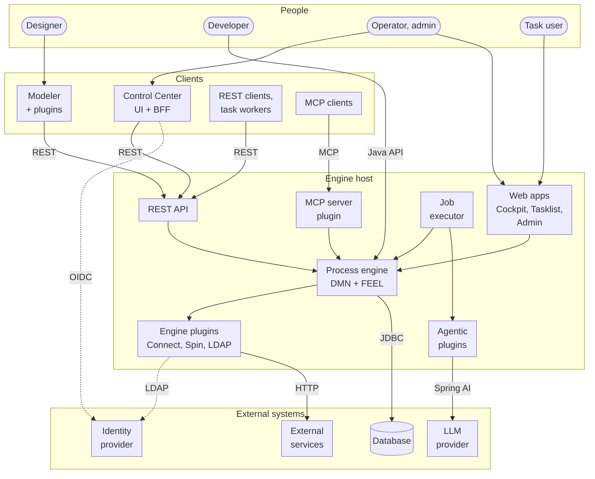

---

title: 'Actors and Actions'
weight: 35

menu:
  main:
    identifier: "user-guide-introduction-actors-and-actions"
    parent: "user-guide-introduction"

---

This page lists the actors in a Fluxnova system and the actions each of them can take. An actor is a person, subsystem or external system that can influence another part of the system. The page covers every released Fluxnova component. It links to the detailed reference pages rather than repeating them.

For engine internals and deployment scenarios see the [Architecture Overview](). For the supported external interfaces see [Public API]() and the [REST API reference](). For hardening guidance see the [Security Instructions]().

<!-- TODO(maintainers): Some component designs exist only in slide decks that are not in GitHub. Please check this page against them and move anything missing here or into the component repositories. -->

# Released Components in Scope

| Component | Repository | Released as | Latest release (Nov 2026) |
|---|---|---|---|
| Process engine, REST API, web applications, engine plugins (Connect, Spin, LDAP identity) | [fluxnova-bpm-platform](https://github.com/finos/fluxnova-bpm-platform) | Maven Central (`org.finos.fluxnova.bpm`), Docker Hub `finos/fluxnova-bpm-platform` | 3.1.1 |
| Control Center | [fluxnova-control-center](https://github.com/finos/fluxnova-control-center) | Docker Hub `finos/fluxnova-control-center` | 1.3.0 |
| Modeler | [fluxnova-modeler](https://github.com/finos/fluxnova-modeler) | Desktop installers on GitHub Releases | 1.3.3 |
| Modeler plugins | [fluxnova-modeler-plugins](https://github.com/finos/fluxnova-modeler-plugins) | GitHub Releases | code-editor-plugin 1.0.0 |
| Engine plugins: backward compatibility, MCP server (agentic) | [fluxnova-plugins](https://github.com/finos/fluxnova-plugins) | Maven Central | bc-plugin 1.0.0, agentic 2.0.0 |
| FEEL engine | [fluxnova-feel-scala](https://github.com/finos/fluxnova-feel-scala) | Maven Central (`org.finos.fluxnova.feel`) | 3.0.0 |
| Testing framework | [fluxnova-testing-framework](https://github.com/finos/fluxnova-testing-framework) | Maven Central (`org.finos.fluxnova.bpm.test`) | 2.0.0 |
| Helm charts | [fluxnova-deploy](https://github.com/finos/fluxnova-deploy) | Source only | No release yet |

The agentic subprocess plugins (`fluxnova-plugins/agentic-subprocess`) and the MCP start event Modeler plugin (`fluxnova-modeler-plugins/plugins/mcp-start-event-plugin`) are included below because they are on `main`, but they have not been released yet.

<!-- TODO(maintainers): Confirm whether fluxnova-deploy, agentic-subprocess and mcp-start-event-plugin count as released assets, and update this table at each release. -->

# Interaction Diagram

The diagram shows the main actors, the components they use and the interfaces between them. Each grouping box is a separate trust boundary (see [Trust Boundaries](#trust-boundaries)). Arrow labels name the interface used, and dotted arrows are authentication flows. The *engine host* is the embedding application, Fluxnova Run or a Spring Boot application. *Engine plugins* also include the backward compatibility plugin. The build and release pipeline is not shown; see [External Actors](#external-actors). Click the diagram to open it full screen.

# Human Actors

| Actor | What they do | Main tools |
|---|---|---|
| **Process designer** | Models BPMN processes, DMN decisions and forms. Configures technical properties such as scripts, element templates, MCP and agent extension attributes. Deploys models to an engine for testing. | [Modeler](), Modeler plugins |
| **Developer** | Embeds the engine in an application or builds a process application. Writes delegate code, scripts, external task workers and tests. Configures engine plugins such as MCP, agentic or LDAP. | [Java API](), [REST API](), [External task client](), [Testing]() |
| **Operator** | Monitors process instances, incidents, jobs, batches and deployments. Repairs failed instances by retrying, modifying, migrating or suspending them. | [Cockpit](), [Control Center]() |
| **Administrator** | Manages users, groups, tenants and authorizations. Configures authentication, the database, the identity provider and the deployment (for example the Helm charts). | [Admin](), [Authorization Service](), [Identity Service]() |
| **Task user** | Claims, works on and completes user tasks, and starts processes they are allowed to start. | [Tasklist]() |
| **Maintainer / release manager** | Merges changes and triggers release workflows that publish Fluxnova artifacts. | GitHub, GitHub Actions |

One person can hold several of these roles. In the engine, roles are modelled as users, groups and [authorizations](), not as fixed role names. The `fluxnova-admin` group is the built-in [administrator group]().

# System Actors

## Fluxnova Components

**Process engine** (`fluxnova-bpm-platform`). A Java library that executes BPMN 2.0 processes, CMMN 1.1 cases and DMN 1.3 decisions, and stores all state in a relational database. Other components act on it through the [Java API]() (in the same JVM) or through the REST API. The engine runs code that comes with deployments, such as [scripts](), expressions and [delegate code](). Anyone who can deploy can therefore run code on the engine host (see [Deployments]()). The engine checks [authorizations]() for the authenticated user when authorization is enabled. The engine also runs the DMN engine, which uses the FEEL engine.

**Job executor** (part of the engine). A background thread pool that acquires and runs [jobs](): timers, asynchronous continuations and batch jobs. It acts on the engine without a user request, using the same database. The agentic subprocess plugins also run their LLM turns as jobs.

**REST API** (`fluxnova-engine-rest`). The HTTP interface to the engine, documented in the [REST API reference]() and part of the [public API](). Authentication is off by default. HTTP Basic authentication against the engine identity service can be enabled ([Configure Authentication]()). As of release 3.1.1, the Spring Boot REST starter and Fluxnova Run can also validate JWT bearer tokens (issuer, audience, signature through a JWKS URL).

<!-- TODO(maintainers): JWT authentication for the REST API (fluxnova.bpm.auth.* / fluxnova.bpm.jwt.*) is described only in AUTH_CONFIGURATION_GUIDE.md in fluxnova-bpm-platform. Please add it to the REST authentication page and link it here. -->

**Web applications** (`fluxnova-bpm-platform/webapps`). [Cockpit]() (titled *Fluxnova Monitoring* in the 3.x UI), [Tasklist](), [Admin]() and the Welcome page. They run in the same server as the engine and are served together with an internal back-end API. Users log in with a session against the engine identity service, which uses the database or LDAP ([Authentication in the Web Applications]()). The web apps' internal API is not part of the public API.

**Engine plugins in the platform** (`fluxnova-bpm-platform/engine-plugins`). [Process engine plugins]() that change engine behaviour when configured. *Connect* lets processes call [external HTTP and SOAP services](). *Spin* handles JSON and XML data formats ([Spin reference]()). *LDAP identity* makes the engine read users and groups from an [LDAP directory]().

**Control Center** (`fluxnova-control-center`). A [web application]() for monitoring and operations. It has an Angular single-page app and a NestJS *backend for frontend* (BFF). The BFF serves the UI, holds the user session, applies CSRF protection and forwards requests to the engine REST API at `FXN_REST_API_URL`. UI login is either off or uses OpenID Connect against an external identity provider. Calls from the BFF to the REST API can carry a client-credentials token from an API gateway (`FXN_API_AUTH_*`). When OIDC is used, the BFF also forwards the user's token in a separate header (`x-fxn-identity-token`). In multi-engine setups it picks the target engine with the `x-fxn-engine` header, which is read by the REST API's `EngineRoutingFilter`. It checks what the user may do by calling the REST authorization check. It can optionally export OpenTelemetry data. Details: Control Center [authentication](https://github.com/finos/fluxnova-control-center/blob/develop/docs/reference/authentication.md), [configuration](https://github.com/finos/fluxnova-control-center/blob/develop/docs/reference/configuration.md) and [tech stack](https://github.com/finos/fluxnova-control-center/blob/develop/docs/reference/tech-stack.md).

<!-- TODO(maintainers): Which engine-side component validates the forwarded x-fxn-identity-token? It is not handled by the REST API's own JWT provider, which reads the Authorization header by default. Is this expected to be an API gateway? -->

**Modeler** (`fluxnova-modeler`). An Electron desktop application ([install](), [user guide]()) for editing BPMN, DMN and form files on the local file system. It deploys models and starts process instances through the engine REST API (`/deployment/create`, `/process-definition/{id}/start`), using no authentication, Basic, a bearer token or OIDC. At startup it loads Modeler plugins from the `resources/plugins` folders of the installation and of the user data directory. Plugins run inside the Modeler with the same privileges as the Modeler itself.

<!-- TODO(maintainers): The Modeler is based on Camunda Modeler. Its code still contains optional outbound calls: Sentry error reporting and Mixpanel usage statistics (enabled only if a DSN or token is set at build time or through flags; RELEASE.yml passes these secrets), and a connector-template updater that calls marketplace.cloud.camunda.io unless the disable-connector-templates flag is set. Please confirm which of these are active in released Fluxnova Modeler builds, and list them as external actors if they are. -->

**Modeler plugins** (`fluxnova-modeler-plugins`). Add-ons the designer installs into the Modeler ([installation guide](https://github.com/finos/fluxnova-modeler-plugins/blob/main/docs/installing-plugins.md)). The released *code-editor-plugin* adds a code editor with syntax highlighting, linting and autocompletion for inline scripts. The unreleased *mcp-start-event-plugin* adds a palette entry for MCP tool start events. Plugins only change what the designer edits. They do not talk to the engine themselves.

**Backward compatibility plugin** (`fluxnova-plugins/fluxnova-backward-compatibility-plugin`). An engine plugin that registers script preprocessors. It rewrites Camunda package and class references in scripts to their Fluxnova equivalents before they run. If anything goes wrong it returns the original script unchanged. ([README](https://github.com/finos/fluxnova-plugins/blob/main/fluxnova-backward-compatibility-plugin/README.md))

**MCP server plugin** (`fluxnova-plugins/agentic`). Two engine plugins that run in the engine host. `mcp-server-plugin` runs a Spring AI MCP server and provides a `ToolRegistry` for other plugins. `mcp-process-start-event` scans deployed BPMN for start events with `mcp:` attributes and registers each one as an MCP tool. When an MCP client calls a tool, the plugin starts the process through the engine Java API (`RuntimeService`) with the tool arguments as variables, and returns the process instance ID and the declared return variables. The transport (for example streamable HTTP or stdio) is set with standard Spring AI properties. The plugin code does not add authentication of its own, and it does not set an authenticated engine user before starting the process. This interface is documented in the [MCP server plugin README](https://github.com/finos/fluxnova-plugins/blob/main/agentic/mcp-server-plugin/README.md) and the [agentic README](https://github.com/finos/fluxnova-plugins/blob/main/agentic/README.md).

<!-- TODO(maintainers): Confirm the intended way to secure the MCP endpoint (for example Spring Security in the host application) and how engine authorizations should apply to MCP-started processes. Then link the guidance here and in the security guide. -->

**Agentic subprocess plugins** (`fluxnova-plugins/agentic-subprocess`, not yet released). Engine plugins that let an LLM drive a BPMN [ad-hoc subprocess](). When the subprocess is entered, and each time a tool activity finishes, a job runs the next turn. The job sends the configured system prompt, the declared context variables and the catalogue of child activities to the LLM provider named in `agent:config`. It then starts the activities the model chose. Providers are Spring AI `ChatModel` beans configured in the host application, for example Ollama or OpenAI. Deployment fails if a BPMN file names a provider that is not configured. ([README](https://github.com/finos/fluxnova-plugins/blob/main/agentic-subprocess/README.md))

**FEEL engine** (`fluxnova-feel-scala`). A Scala library that parses and evaluates FEEL expressions. The DMN engine uses it to evaluate decision tables and expressions ([FEEL Engine]()). It has no network interface. It only evaluates expressions that come from deployed models, with the variables it is given.

**Testing framework** (`fluxnova-testing-framework`). Maven libraries and an archetype for testing BPMN models and scripts. Tests deploy models into an in-memory engine and produce process and script coverage reports. It runs only in the developer's build or CI, never in a production engine. ([README](https://github.com/finos/fluxnova-testing-framework/blob/main/README.md))

**Helm charts** (`fluxnova-deploy`). Example Kubernetes charts for an engine image (with a PostgreSQL database, credentials taken from a Kubernetes secret) and for the Control Center image. Both sit behind an nginx ingress with TLS from cert-manager. Workflows in the repository can deploy them to a sandbox EKS cluster.

## External Actors

**Embedding application.** A Java application (plain Java, Spring, Spring Boot, Quarkus or Jakarta EE) that creates and owns the process engine. It has full access through the Java API, decides which plugins, REST API and web apps are enabled, and provides delegate code. Engine authorization checks only apply if it sets an authenticated user ([Embedded Process Engine]()).

**REST clients.** Any HTTP client, such as a custom application, Control Center, the Modeler or a script, that uses the REST API. What it can do depends on the authentication configured and on the authorizations of its user.

**External task workers.** Separate processes that fetch and lock [external tasks]() over REST, do the work outside the engine, and report completion, failure or BPMN errors. They usually use the [Java external task client]().

**MCP clients.** AI assistants or agents, for example Claude Desktop, a custom LLM agent or MCP Inspector. They connect to the MCP server plugin, list the available tools and call them, which starts processes.

**LLM providers.** Model APIs (hosted or self-hosted) that the agentic subprocess plugins call through Spring AI. Their responses decide which BPMN activities run next.

**Identity providers.** Systems that authenticate users:
* the engine's own database-backed identity service, or an LDAP directory through the LDAP plugin, for REST Basic authentication and web app login;
* an OIDC provider for Control Center login and, optionally, for JWT validation in the REST API (through its JWKS URL);
* an OIDC provider used by the Modeler when a deployment endpoint is set to OIDC;
* an OAuth2 provider for applications that use the [Spring Security OAuth2 integration]().

**Database.** The relational database where the engine stores definitions, runtime state, history, users and authorizations ([Database]()). Anyone with direct write access to it can bypass all engine checks.

**External services.** Systems that processes call, through Connect connectors, delegate code, scripts or external task workers.

**Observability back end.** An optional OpenTelemetry collector that receives traces, metrics and logs from Control Center.

**CI and release pipeline.** GitHub Actions workflows in each repository build and test changes. Release workflows, triggered by maintainers, publish signed Maven artifacts to Maven Central, Docker images to Docker Hub (and GHCR for `main` builds), Modeler installers and plugin bundles to GitHub Releases, and Javadoc and OpenAPI files to GitHub Pages. Users then pull these artifacts into their own deployments.

# Actions

| Actor | Action | Component | Interface | Details |
|---|---|---|---|---|
| Process designer | Create and edit BPMN, DMN and form models, including scripts, MCP and agent attributes | Modeler, Modeler plugins | Desktop UI, local files | [Modeler]() |
| Process designer, developer | Deploy models and start process instances | Engine | REST (`/deployment/create`, `/process-definition/{id}/start`) from the Modeler or other clients | [REST API](), [Deployments]() |
| Developer, embedding application | Embed and configure the engine, register plugins, run all engine services | Engine | Java API, configuration | [Public API](), [Bootstrapping](), [Engine plugins]() |
| Developer | Provide code that the engine runs (delegates, listeners, scripts, expressions) | Engine | Java SPI, deployment resources | [Delegation Code](), [Securing Custom Code]() |
| Developer | Test models and scripts against an in-memory engine | Testing framework | Maven, JUnit | [Testing](), [framework README](https://github.com/finos/fluxnova-testing-framework/blob/main/README.md) |
| Operator | Search instances, incidents, jobs, batches and deployments; retry, modify, migrate, suspend or delete them | Engine | Cockpit UI or Control Center UI, which call REST | [Cockpit](), [Control Center]() |
| Administrator | Manage users, groups, tenants and authorizations | Engine identity and authorization services | Admin UI, REST, Java API | [Authorization Service](), [Admin]() |
| Administrator | Configure authentication, TLS, database, LDAP or OIDC, and deployment | Engine host, Control Center, Helm charts | Configuration files, environment variables, Helm values | [Security Instructions](), [Multi-Tenancy]() |
| Task user | List, claim, complete and delegate tasks; start processes | Engine | Tasklist UI, REST | [Tasklist]() |
| REST client | Any operation in the REST reference, limited by authentication and authorizations | Engine | REST (Basic, JWT or none) | [REST API](), [Configure Authentication]() |
| Control Center BFF | Forward UI requests, check user authorizations, select engine and tenant | Engine | REST, `x-fxn-engine` header | [Control Center authentication](https://github.com/finos/fluxnova-control-center/blob/develop/docs/reference/authentication.md) |
| External task worker | Fetch and lock, complete, fail or raise a BPMN error for external tasks | Engine | REST | [External Tasks](), [External Task Client]() |
| Job executor | Run timers, asynchronous continuations, batch jobs and agentic turns | Engine | Internal (database job table) | [The Job Executor]() |
| Engine (Connect, delegates, scripts) | Call external HTTP or SOAP services | External services | HTTP or SOAP | [Connectors]() |
| Engine | Read and write all process state | Database | JDBC | [Database]() |
| Engine (LDAP plugin), REST API (JWT) | Look up users and groups, validate tokens | Identity provider | LDAP, HTTPS (JWKS) | [Identity Service]() |
| MCP client | List tools; call a tool, which starts a process and returns the declared variables | MCP server plugin, Engine | MCP (Spring AI transport) | [MCP server plugin README](https://github.com/finos/fluxnova-plugins/blob/main/agentic/mcp-server-plugin/README.md) |
| Agentic subprocess plugins | Send prompt, context and tool catalogue to an LLM; start the activities it selects | LLM provider, Engine | Spring AI `ChatModel`, Java API | [agentic-subprocess README](https://github.com/finos/fluxnova-plugins/blob/main/agentic-subprocess/README.md) |
| DMN engine | Evaluate FEEL expressions | FEEL engine | Java/Scala library call | [FEEL Engine]() |
| Backward compatibility plugin | Rewrite Camunda references in scripts before they run | Engine scripting | Script preprocessor SPI | [README](https://github.com/finos/fluxnova-plugins/blob/main/fluxnova-backward-compatibility-plugin/README.md) |
| Maintainer, CI and release pipeline | Build, test, sign and publish artifacts | All repositories | GitHub Actions, Maven Central, Docker Hub, GitHub Releases | [Security Guide]() |
| Administrator, CI | Install or upgrade Fluxnova on Kubernetes | Helm charts | Helm, kubectl | [fluxnova-deploy](https://github.com/finos/fluxnova-deploy) |

# Trust Boundaries

* **Browser to server.** The web apps and Control Center UIs run in the user's browser. The server side (the web app back end or the Control Center BFF) holds the session and enforces authentication.
* **Client to REST API.** Everything that is not in the engine's JVM reaches the engine through the REST API, or through the MCP endpoint when that plugin is installed. REST authentication is off by default and must be enabled in production ([Security Instructions]()).
* **In-process code.** The embedding application, engine plugins, delegate code and deployed scripts all run inside the engine JVM with full engine access. Engine authorization checks do not restrict them.
* **Engine to external systems.** The database, identity providers, LLM providers and external services are outside the Fluxnova code base. The operator is responsible for securing them.
* **Supply chain.** Users trust artifacts published by the release pipeline. See the [Security Guide]() for the security policy and how to report vulnerabilities.

When a component, actor or interface is added or changed, update this page in the same pull request.
